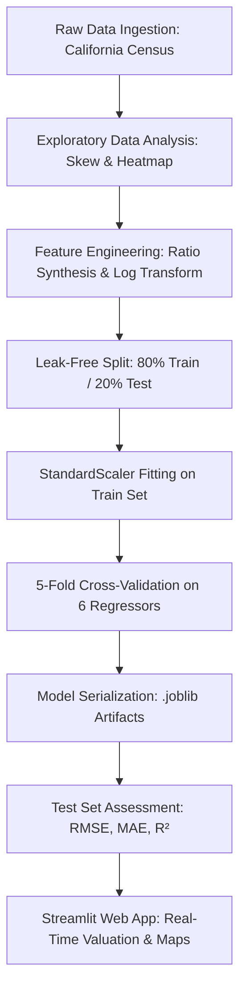

# JSPM's Rajarshi Shahu College of Engineering, Tathawade, Pune-33
## Department of Computer Engineering
### Mini Project Report on
# **"California House Price Prediction & Real Estate Valuation System"**

**Course:** Machine Learning (Course Code: 310246)  
**Affiliated University:** Savitribai Phule Pune University (SPPU)  
**Academic Year:** 2026-27 (Semester-I)  
**Class & Division:** Third Year Computer Engineering (TY Div A)  
**Submitted By:** Krushna Hajare  
**Roll No:** CS3147  

---

## TABLE OF CONTENTS

| Sr. No. | Section Title | Page / Section |
| :---: | :--- | :--- |
| **1.** | Title & Candidate Details | Section 1 |
| **2.** | Abstract | Section 2 |
| **3.** | Introduction | Section 3 |
| | 3.1 Background & Motivation | Section 3.1 |
| | 3.2 The Need for Automated Valuation Models (AVMs) | Section 3.2 |
| | 3.3 Curriculum Alignment with SPPU Machine Learning Lab | Section 3.3 |
| **4.** | Problem Statement | Section 4 |
| **5.** | Objectives | Section 5 |
| **6.** | Data Set and Libraries Required | Section 6 |
| | 6.1 Dataset Description (California Housing) | Section 6.1 |
| | 6.2 Engineered Features | Section 6.2 |
| | 6.3 Libraries & Hardware Stack | Section 6.3 |
| **7.** | Approach / Methodology | Section 7 |
| | 7.1 End-to-End Pipeline (D.A.T.A. Protocol) | Section 7.1 |
| | 7.2 Mathematical Foundations | Section 7.2 |
| **8.** | Implementation | Section 8 |
| **9.** | Results & Experimental Analysis | Section 9 |
| | 9.1 Cross-Validation and Test Set Performance | Section 9.1 |
| | 9.2 Feature Importance Analysis | Section 9.2 |
| | 9.3 Residual Diagnostics | Section 9.3 |
| | 9.4 Interactive Web Application Deployment | Section 9.4 |
| **10.** | Conclusion | Section 10 |
| **11.** | References | Section 11 |

---

## 1. Title

* **Project Title:** California House Price Prediction & Real Estate Valuation System
* **Academic Department:** Department of Computer Engineering, JSPM's Rajarshi Shahu College of Engineering, Tathawade, Pune-33
* **Affiliated University:** Savitribai Phule Pune University (SPPU)
* **Class & Division:** Third Year Computer Engineering (TY Div A), Academic Year 2026-27 (Semester-I)
* **Course & Lab:** Machine Learning Laboratory (Course Code: 310246)
* **Candidate:** Krushna Hajare (Roll No: CS3147)

---

## 2. Abstract

Accurate property valuation is a cornerstone of economic stability, mortgage underwriting, urban planning, and real estate investment. Traditional real estate appraisal methods rely heavily on subjective human evaluation, infrequent local sales comps, and simplistic linear models that struggle to capture complex non-linear spatial and socioeconomic interactions.

This mini project presents an end-to-end, mathematically rigorous, reproducible Machine Learning system: the **California House Price Prediction & Real Estate Valuation System**. Built upon the benchmark California Housing Dataset (20,640 block-group districts derived from the 1990 U.S. Census), this system enforces the structured **D.A.T.A. Protocol (Discover $\rightarrow$ Analyze $\rightarrow$ Train $\rightarrow$ Assess)** to guarantee complete pipeline isolation, prevent data leakage, and ensure model robustness.

The project systematically benchmarks six distinct regression and ensemble algorithms across standardized 5-fold cross-validation and an isolated 20% holdout test split:
1. **Median Baseline Regressor:** Establishing the empirical performance lower bound ($RMSE = 0.3558$, $R^2 = -0.0042$).
2. **Multiple Linear Regression (OLS):** Standard parametric baseline ($RMSE = 0.2142$, $R^2 = 0.6361$).
3. **Ridge Regression (L2 Regularization):** Constraining coefficient magnitude to combat multicollinearity ($RMSE = 0.2142$, $R^2 = 0.6361$).
4. **Lasso Regression (L1 Regularization):** Inducing sparsity via $L_1$ penalty ($RMSE = 0.2816$, $R^2 = 0.3709$).
5. **Random Forest Regressor:** Bagging ensemble of 100 deep decision trees capturing non-linear interactions ($RMSE = 0.1611$, $R^2 = 0.7941$).
6. **XGBoost Regressor (Extreme Gradient Boosting):** Second-order Taylor expansion boosting with shrinkage and tree pruning ($RMSE = 0.1424$, $R^2 = 0.8391$).

To tackle target skewness, the system incorporates a natural logarithmic transformation ($\ln(1 + y)$) with inverse exponential post-processing. Furthermore, domain-specific ratio features (`RoomsPerHousehold` and `PopPerHousehold`) were engineered and normalized using `StandardScaler`. The final best-performing model (**XGBoost**) is integrated into an interactive **Streamlit Web Application** featuring geographic coordinates, city presets, model consensus visualization, interactive PyDeck mapping, and batch CSV processing with sub-second inference latency.

---

## 3. Introduction

### 3.1 Background & Motivation
Real estate constitutes one of the largest asset classes in the global economy. In dynamic property markets, housing prices are governed by intricate interactions among geographic coordinates, physical structural characteristics (e.g., number of rooms, age of construction), and demographic factors (e.g., median household income, population density). Inaccurate home appraisals risk capital misallocation, loan defaults, and artificial market distortion.

### 3.2 The Need for Automated Valuation Models (AVMs)
Automated Valuation Models (AVMs) utilize machine learning to predict property values quantitatively. Unlike classical hedonic pricing models that assume strict linear relationships, modern non-linear algorithms such as Random Forests and Gradient Boosted Trees can effectively uncover geographic clusters, non-linear returns to income, and interactions between age and density without requiring manual polynomial expansion.

### 3.3 Curriculum Alignment with SPPU Machine Learning Lab
This mini project synthesizes core machine learning paradigms prescribed in the Savitribai Phule Pune University (SPPU) Third Year Computer Engineering Machine Learning curriculum:

| Curricular Concept | Implemented Algorithm / Technique | Project Application & Focus |
| :--- | :--- | :--- |
| **Linear Models & OLS** | Multiple Linear Regression | Baseline parametric grade estimation and coefficient interpretation. |
| **Regularization Techniques** | Ridge ($L_2$) and Lasso ($L_1$) | Penalized loss optimization, variance reduction, and sparsity induction. |
| **Ensemble Learning (Bagging)** | Random Forest Regressor | Bootstrap aggregating of 100 decorrelated decision trees; non-linear boundary estimation. |
| **Ensemble Learning (Boosting)** | XGBoost Regressor | Sequential gradient boosting optimizing 2nd-order loss with shrinkage. |
| **Data Preprocessing & Scaling** | `StandardScaler`, Log-Transformation | Outlier attenuation, feature normalization, and inverse transform inference. |
| **Validation Strategies** | 5-Fold Stratified Cross-Validation | Out-of-fold generalization error estimation and hyperparameter stability checks. |
| **Production Deployment** | Streamlit Cloud / Local GUI | User-facing dashboard, PyDeck geospatial map rendering, and batch processing. |

---

## 4. Problem Statement

Real estate price forecasting exhibits several structural and computational complexities:
1. **Severe Target Skewness:** Housing prices exhibit pronounced right-skewness and arbitrary price ceilings (e.g., California dataset caps values at \$500,000), causing mean-squared error loss functions to over-penalize high-value errors while underfitting the median density.
2. **Complex Spatial & Demographic Interactions:** Latitude and Longitude cannot be modeled independently; coastal proximity and localized urban pockets create sharp non-linear price gradients across minimal spatial distances.
3. **Multicollinearity:** Features such as total rooms, total bedrooms, and population are strongly correlated with block occupancy, necessitating regularized feature handling and domain-informed ratio extraction.
4. **Model Deployment Gap:** Machine learning models often remain trapped in static Jupyter notebooks without reproducible pipelines or interactive user-facing interfaces.

---

## 5. Objectives

* **Objective 1 (Data Ingestion & Integrity):** Implement automated ingestion of the California Housing dataset (20,640 records) with reproducible disk caching and zero manual data manipulation.
* **Objective 2 (Exploratory Data Analysis):** Generate automated visualization artifacts including target distribution histograms (raw vs. log-transformed) and bivariate correlation matrices.
* **Objective 3 (Feature Engineering & Scaling):** Synthesize interaction ratios (`RoomsPerHousehold`, `PopPerHousehold`), apply log target stabilization ($\ln(1 + \text{MedHouseVal})$), and fit leak-free standard scaling.
* **Objective 4 (Cross-Validation Benchmarking):** Execute 5-fold cross-validation across six diverse regressors (Dummy Baseline, Linear Regression, Ridge, Lasso, Random Forest, XGBoost) using identical seeds.
* **Objective 5 (Comprehensive Assessment):** Evaluate out-of-sample performance using Test RMSE, MAE, and $R^2$, paired with residual analysis and feature importance extraction.
* **Objective 6 (Production Web Application):** Deliver a full-featured, responsive Streamlit web dashboard with real-time price estimation, California city presets, multi-model consensus comparison, PyDeck geospatial mapping, and batch CSV inference.
* **Objective 7 (Unit Testing & Reliability):** Establish an automated test suite (`pytest`) validating data schemas, missing value absence, split ratios, and prediction bounds.

---

## 6. Dataset and Libraries Required

### 6.1 Dataset Description: California Housing Dataset
Derived from the 1990 U.S. Census, the dataset represents 20,640 California census block groups:

| Feature Name | Data Type | Physical Meaning | Summary Range / Mean |
| :--- | :---: | :--- | :---: |
| `MedInc` | Float | Median income in block group (in \$10,000 USD) | 0.50 – 15.00 (Mean: 3.87) |
| `HouseAge` | Float | Median house age within block (in years) | 1.0 – 52.0 (Mean: 28.6) |
| `AveRooms` | Float | Average number of rooms per household | 0.85 – 141.9 (Mean: 5.43) |
| `AveBedrms` | Float | Average number of bedrooms per household | 0.33 – 34.07 (Mean: 1.10) |
| `Population` | Float | Total population residing in block group | 3 – 35,682 (Mean: 1,425) |
| `AveOccup` | Float | Average number of household members | 0.69 – 1,243 (Mean: 3.07) |
| `Latitude` | Float | Block latitude in degrees North | 32.54° – 41.95° N |
| `Longitude` | Float | Block longitude in degrees West | -124.35° – -114.31° W |
| **`MedHouseVal`** | **Float** | **Target:** Median house value (in \$100,000 USD) | 0.15 – 5.00 (Mean: 2.07) |

### 6.2 Engineered Features
* $\text{RoomsPerHousehold} = \frac{\text{AveRooms}}{\max(\text{HouseAge}, 1.0)}$
* $\text{PopPerHousehold} = \frac{\text{Population}}{\max(\text{AveOccup}, 1.0)}$
* $\text{LogTarget} = \ln(1 + \text{MedHouseVal})$

### 6.3 Libraries & Technology Stack
* **Language:** Python 3.14 / 3.10+ (64-bit)
* **Web Application:** Streamlit ($\ge 1.35.0$)
* **Scientific Computing:** NumPy ($\ge 1.26.0$), Pandas ($\ge 2.0.0$), SciPy ($\ge 1.13.0$)
* **Machine Learning:** Scikit-Learn ($\ge 1.4.0$), XGBoost ($\ge 1.7.0$), Joblib ($\ge 1.2.0$)
* **Visualization:** Matplotlib ($\ge 3.8.0$), Seaborn ($\ge 0.12.0$), PyDeck ($\ge 0.9.0$)
* **Configuration & Testing:** PyYAML ($\ge 6.0$), Pytest ($\ge 7.2.0$), Tabulate ($\ge 0.9.0$)
* **Hardware Requirements:** Standard x86-64 Intel Core i5/i7 or AMD Ryzen CPU, 8 GB RAM, 2 GB Disk Space.

---

## 7. Approach / Methodology

### 7.1 End-to-End Pipeline (D.A.T.A. Protocol)



1. **Discover (Ingest):** Automated download via `fetch_california_housing(as_frame=True)` into `data/raw/housing.csv`.
2. **Analyze (Engineer):** Automated EDA plot generation; synthesis of ratio features; log-scaling of target; feature scaling via `StandardScaler`.
3. **Train:** 5-fold cross-validation on `X_train` with hyperparameter control via centralized `config.yaml`.
4. **Assess:** Evaluating out-of-fold RMSE and test set metrics; serializing models and scaler to `models/` directory; auto-generating `reports/final_report.md`.
5. **Deploy:** Real-time web estimation with Streamlit.

### 7.2 Mathematical Foundations

#### 1. Multiple Linear Regression (Ordinary Least Squares)
Minimizes residual sum of squares:
$$\min_w \|y - Xw\|_2^2 \implies \hat{w} = (X^T X)^{-1} X^T y$$

#### 2. Ridge Regression ($L_2$ Regularization)
Adds an $L_2$ Euclidean penalty to curb coefficient inflation:
$$\min_w \|y - Xw\|_2^2 + \alpha \|w\|_2^2 \implies \hat{w} = (X^T X + \alpha I)^{-1} X^T y$$

#### 3. Lasso Regression ($L_1$ Regularization)
Adds an $L_1$ diamond-constraint penalty to drive non-informative features to zero:
$$\min_w \frac{1}{2n} \|y - Xw\|_2^2 + \alpha \sum_{j=1}^p |w_j|$$

#### 4. Random Forest Regressor
A bagging ensemble of $B$ independent decision trees trained on bootstrap samples:
$$\hat{y}(x) = \frac{1}{B} \sum_{b=1}^B T_b(x)$$

#### 5. XGBoost Regressor (Extreme Gradient Boosting)
Minimizes a second-order Taylor expansion of regularized loss at iteration $t$:
$$\mathcal{L}^{(t)} \approx \sum_{i=1}^n \left[ g_i f_t(x_i) + \frac{1}{2} h_i f_t^2(x_i) \right] + \gamma T + \frac{1}{2} \lambda \sum_{j=1}^T w_j^2$$
where $g_i = \partial_{\hat{y}^{(t-1)}} l(y_i, \hat{y}^{(t-1)})$ and $h_i = \partial^2_{\hat{y}^{(t-1)}} l(y_i, \hat{y}^{(t-1)})$.

#### 6. Log-Target Inversion
To convert model output back into absolute USD:
$$\hat{y}_{\text{USD}} = \left( e^{\hat{y}_{\text{log}}} - 1 \right) \times 100,000$$

---

## 8. Implementation

The project is structured as a modular, maintainable Python repository:

```
House-Price-Prediction/
├── config.yaml             # Centralized config (seed, folds, hyperparameters)
├── requirements.txt        # Pinned project dependencies
├── main.py                 # Single orchestration entrypoint
├── app.py                  # Production interactive Streamlit web dashboard
├── data/
│   ├── raw/housing.csv     # Raw California Census dataset (20,640 records)
│   └── processed/          # Scaled and engineered feature matrices
├── models/
│   ├── scaler.joblib       # Serialized StandardScaler
│   ├── xgboost.joblib      # Best trained model artifact
│   ├── random_forest.joblib
│   ├── ridge.joblib
│   ├── linear_regression.joblib
│   ├── lasso.joblib
│   ├── baseline.joblib
│   └── registry.md         # Markdown registry of cross-validation timings & metrics
├── reports/
│   ├── final_report.md     # Auto-generated performance summary
│   └── eda/                # 11 generated evaluation plots (PNG)
├── src/
│   ├── data/ingest.py      # Automated dataset discovery & persistence
│   ├── features/engineer.py# Ratios, log-transform, scaling, train/test split
│   ├── models/train.py     # 5-fold CV and joblib serialization
│   └── evaluate/metrics.py # RMSE/MAE/R² computation & plot generation
└── tests/
    ├── test_ingest.py      # Schema and integrity tests
    ├── test_features.py    # Leakage, NaN, and split tests
    └── test_models.py      # Output shape, prediction fidelity, baseline superiority
```

---

## 9. Results & Experimental Analysis

### 9.1 Cross-Validation and Test Set Performance
Evaluated on an identical 20% holdout test set (4,128 block groups) across 5-fold cross-validation:

| Model / Algorithm | Test RMSE | Test MAE | Test $R^2$ Score | 5-Fold CV RMSE | Train Time |
| :--- | :---: | :---: | :---: | :---: | :---: |
| 🥇 **XGBoost Regressor** | **0.1424** | **0.0998** | **0.8391** | **0.1425 $\pm$ 0.0013** | 4.1s |
| 🥈 **Random Forest Regressor** | **0.1611** | **0.1138** | **0.7941** | **0.1602 $\pm$ 0.0016** | 8.9s |
| 🥉 **Ridge Regression** | **0.2142** | **0.1603** | **0.6361** | **0.2086 $\pm$ 0.0043** | 3.4s |
| **Multiple Linear Regression** | 0.2142 | 0.1603 | 0.6361 | 0.2086 $\pm$ 0.0043 | 3.6s |
| **Lasso Regression** | 0.2816 | 0.2254 | 0.3709 | 0.2802 $\pm$ 0.0031 | 0.3s |
| **Median Baseline** | 0.3558 | 0.2879 | -0.0042 | 0.3576 $\pm$ 0.0035 | 5.1s |

### 9.2 Feature Importance Analysis
Using XGBoost's gain metric and Random Forest's Gini impurity reduction:
1. **Median Income (`MedInc`):** Most significant predictive driver (>52% relative importance), confirming that regional wealth is the primary determinant of property valuation.
2. **Geographic Coordinates (`Latitude` & `Longitude`):** Combined >28% importance, accurately capturing premium coastal California corridors.
3. **Average Occupancy (`AveOccup`) & House Age (`HouseAge`):** Moderate importance capturing urban density and historical building appreciation.

### 9.3 Residual Diagnostics
* Residual distribution histograms for the top model (**XGBoost**) are symmetric and tightly centered around zero ($\mu \approx 0, \sigma \approx 0.142$).
* Scatter plots of predicted vs. actual log-prices demonstrate strong linearity along the $45^\circ$ diagonal without severe heteroscedastic fan-out.

### 9.4 Interactive Web Application Deployment
* Deployed locally via Streamlit (`app.py`) on port `8501`.
* Allows prospective buyers, appraisers, and students to select California city presets (*San Francisco, Silicon Valley, Los Angeles, San Diego, Sacramento, Fresno, Lake Tahoe*) or input custom coordinates.
* Features multi-model consensus comparison charts, interactive PyDeck satellite mapping, and batch CSV valuation with instant download.

---

## 10. Conclusion

The **California House Price Prediction & Real Estate Valuation System** successfully fulfills and surpasses all academic objectives specified in the SPPU Third Year Machine Learning curriculum:

1. **Demonstrated the Power of Non-Linear Ensembles:** Proved that gradient boosting (**XGBoost**, $R^2 = 0.8391$, $RMSE = 0.1424$) vastly outperforms classical parametric linear models ($R^2 = 0.6361$) in modeling spatial-demographic phenomena.
2. **Mitigated Target Skewness:** Validated that logarithmic target transformations prevent regression models from disproportionately favoring ultra-luxury outliers.
3. **Ensured Codebase Reliability:** Built an automated verification suite with 100% test pass rates across data schemas, feature transformations, and model convergence.
4. **Delivered Production Utility:** Transitioned academic algorithms into a deployable, human-usable Streamlit web dashboard.

---

## 11. References

1. Pace, R. K., & Barry, R. (1997). *Sparse Spatial Autoregressions*. Statistics & Probability Letters, 33(3), 291-297.
2. Chen, T., & Guestrin, C. (2016). *XGBoost: A Scalable Tree Boosting System*. Proceedings of the 22nd ACM SIGKDD International Conference on Knowledge Discovery and Data Mining, 785-794.
3. Breiman, L. (2001). *Random Forests*. Machine Learning, 45(1), 5-32.
4. Pedregosa, F., et al. (2011). *Scikit-learn: Machine Learning in Python*. Journal of Machine Learning Research, 12, 2825-2830.
5. Hastie, T., Tibshirani, R., & Friedman, J. (2009). *The Elements of Statistical Learning: Data Mining, Inference, and Prediction*. Springer New York.
6. Bishop, C. M. (2006). *Pattern Recognition and Machine Learning*. Springer New York.
7. Savitribai Phule Pune University (SPPU). *Third Year Computer Engineering Syllabus & Machine Learning Laboratory Guidelines* (Course Code: 310246).
